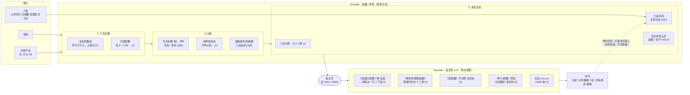
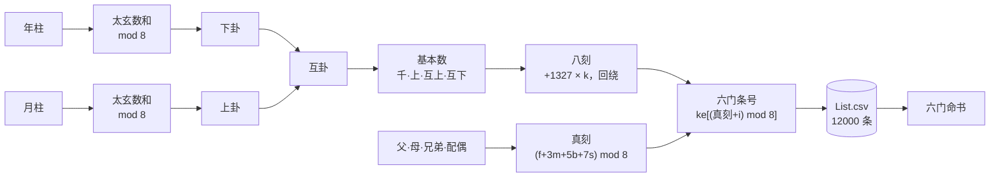
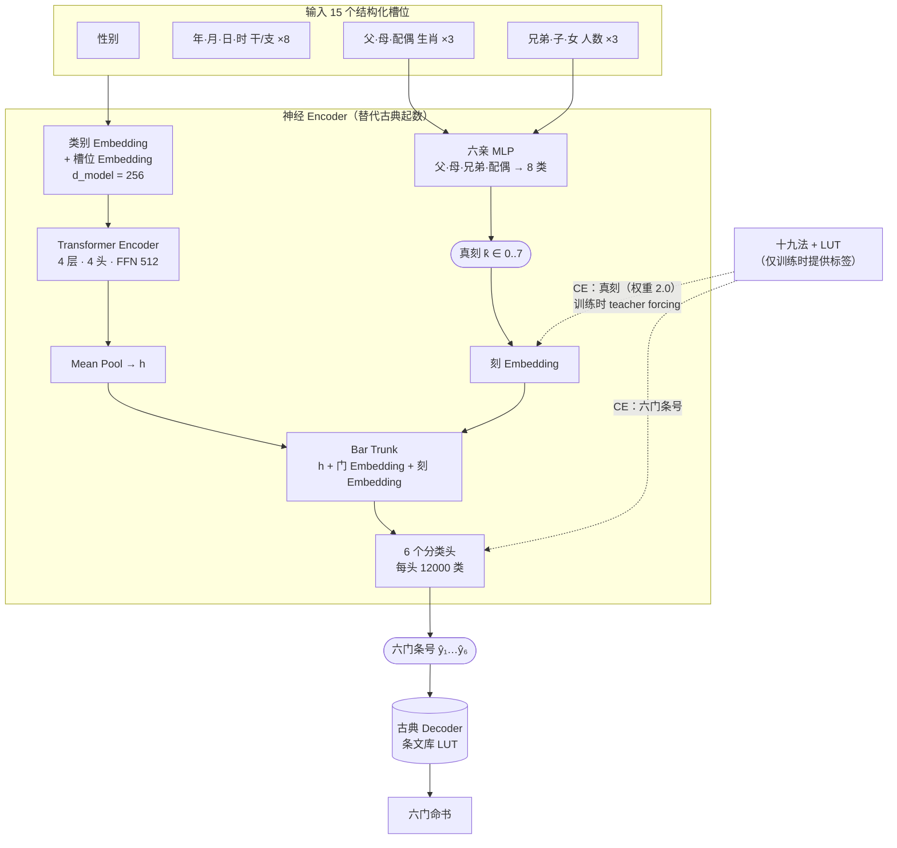
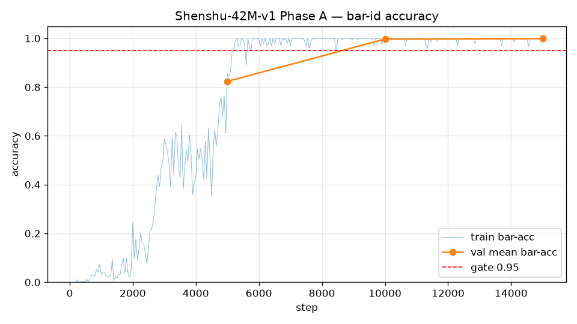

# 铁板神数 Transformer（Transformer神数）

**铁板神数 · 鐵板神數 · 铁版神数 · Tieban Shenshu · Iron Plate Divine Numbers — 用深度学习复现铁板神数起数与命书**

[](#3-当前架构shenshu-42m-v1)
[](#训练结果)
[](#快速开始)
[](LICENSE)

用 Transformer 学习**铁板神数**的「起数 → 条文」映射：输入四柱八字与六亲，模型推出六门命书的条文号，再查条文库得到命书。

> **English summary.** *Tieban Shenshu* (铁板神数, "Iron Plate Divine Numbers") is a traditional Chinese fortune-telling method that maps birth pillars (BaZi) and family zodiac signs to numbered verses in a ~12,000-entry book. This project trains a 21M-parameter Transformer on 42M samples to reproduce the classical number-derivation step, reaching 99.87% verse-ID accuracy on held-out year/month pillars. Weights are released as safetensors.

在这个项目的视角下，铁板神数本身就是一个 **Encoder–Decoder** 系统：

- **Encoder（起数、考刻）**：把生辰和六亲编码成条文号。
- **Decoder（条文库）**：按条文号查出断语。

当前模型 **Shenshu-42M-v1** 用神经网络学这个 Encoder。在训练集里**从未出现过的输入**上，它也能逐条复现古典算法的结果（见[例子 A / B](#例子-a--b数据集外输入模型-vs-十九法)）。

> 本项目是传统文化 × 机器学习的研究原型，不是任何铁板神数传本的官方实现，也不对命理的有效性做任何背书（参见[真伪争论](#15-真伪争论)）。

---

## 目录

1. [铁板神数理论](#1-铁板神数理论)
2. [古典铁板神数架构图（Encoder / Decoder 流派）](#2-古典铁板神数架构图)
3. [当前架构：Shenshu-42M-v1](#3-当前架构shenshu-42m-v1)
4. [例子 A / B：数据集外输入，模型 vs 十九法](#例子-a--b数据集外输入模型-vs-十九法)
5. [快速开始（命令行演示）](#快速开始)
6. [训练结果](#训练结果)
7. [数据与仓库布局](#数据与仓库布局)
8. [Contributors](#contributors)
9. [参考文献](#参考文献)

---

## 1. 铁板神数理论

### 1.1 定义与源流

**铁板神数**又称铁版神数、铁板算命、太极数，俗称「铁算盘」。它是中国术数的一种：

1. 用出生年月日时的干支配卦；
2. 核对父母、兄弟、夫妻、子女的生肖与人数；
3. 用算盘起数，求出「铁板数序」；
4. 按数序查出对应的谶语（条文）。<sup>[1]</sup>

**托名邵雍，实则晚出。** 传统说法托名北宋邵雍（康节），称其据《皇极经世》数理创立。<sup>[1][8]</sup>

- 据称邵雍担心儿子不能传其学，作《蠢子数》传子，只要依法推算，就能知人生死贵贱。<sup>[1]</sup>
- 明代杨慎已经批评：「今世游食术人妄造大定数、蠢子数托名康节，岂不厚诬前贤？」<sup>[3]</sup>
- 维基百科综述认为，此术借用了邵雍的易学概念，并非邵雍本人所创。从宋到清，可考文献中都没有对它的确实描述。<sup>[1]</sup>

**清代中叶兴起，与铁道人有关。** 此术在清代乾隆、嘉庆年间兴起。相传清中叶的**铁卜子（铁道人）**大幅校订了条文，仍尊邵雍为原作者，自居「校」者。「铁版」一说即指「铁卜子版本」。<sup>[1]</sup>

据[1]，铁道人的取材十分庞杂，包括：

- 河洛数序、卦策数序、五行干支；
- 紫微斗数、子平命法、七政四余；
- 清代刘斯组的切音法；
- 以《皇极经世》的局数数序为经纬。

**清人笔记里的实际操作。** 俞樾《春在堂随笔》记有太极数推算的现场<sup>[2]</sup>：

> 「客以生所值支干告之，其人就算盘推算，珠走如飞……算已，谓其仆曰：几千几百几十有几，仆即于几上检书一册示之。」

这段记载正好对应「**数 → 查书**」的两段式结构，也就是本项目所说的 Encoder → Decoder。《清稗类钞》也记有光绪朝易顺鼎在河南遇星士推铁板神数的事。<sup>[4]</sup>

### 1.2 Encoder：起数与考刻

古典 Encoder 的任务是：把 **(性别, 四柱干支, 六亲)** 映射成**条文号**。各家方法在三个环节上有差别：数怎么来、卦怎么起、刻怎么定。

| 环节 | 方法 / 口诀 | 要点 | 出处 |
|---|---|---|---|
| 干支化数 | **太玄配数诀** | 甲己子午九，乙庚丑未八，丙辛寅申七，丁壬卯酉六，戊癸辰戌五，巳亥单四数 | [1] |
| 干支化数 | **地支配数诀（河洛数）** | 亥子一六水，寅卯三八木，巳午二七火，申酉四九金，辰戌丑未五十土 | [1] |
| 干支配卦 | **天干 / 地支配卦（纳甲）** | 壬甲从乾数，癸乙向坤求……；亥子坎宫寅卯震…… | [1] |
| 数化卦 | **先天卦数** | 乾1 兑2 离3 震4 巽5 坎6 艮7 坤8，取余数起卦，再取互卦、变卦 | [1][6] |
| 轨策 / 元会运世 | **皇极经世数理** | 轨数、策数配先、后天卦，经复杂演算得到四到五位数，千百十个位分作元、会、运、世 | [6][8] |
| 考时定刻 | **八刻分命** | 一时辰分八刻，一刻十五分；「八刻分命妙无穷，九十六局见天工」 | [1] |
| 六亲考刻 | **定刻分诀** | 「甲乙斗宫定刻分，十二生肖作用神……迂回辗转推六亲」：用父母、兄弟、配偶的生肖来校验真刻 | [1][7] |
| 先天考刻公式 | **TiebanshenshuOS 实现** | 终局条文数 = 本命基数 + 刻干数 × 48 | [7] |
| 本项目所用 | **「十九法」规则链** | 太玄数 → 年月起先天卦 → 互卦 → 基本数 → 八刻（步长 1327）→ 六亲选真刻 → 六门条号 | 本仓库，见 1.4 |

据业者说，实际批命先做「**考时定刻**」：先打出若干条文问客人是否正确，以此把出生时间校准到「刻」，然后再打出六亲、各年岁的条文，整理成命书。<sup>[1]</sup>

### 1.3 Decoder：条文库（LUT）

古典 Decoder 是一张**确定性查表**：条文号 → 一句断语。不同的传本就是不同的「Decoder 权重」。

| 传本 / 谱系 | 说明 | 出处 |
|---|---|---|
| 《皇极分经数》（明，宫廷御用） | 与《铁版神数》条文最为相似，被认为是坊间**岭南派一万二千条文版本**的始祖 | [1] |
| 《神机妙算铁版数》（清道光刻本，十三卷） | 坊间流通条文大多抄自此本；收录于《续修四库全书》子部 | [1] |
| 《铁版数》不分卷（旧钞本） | 同样收录于《续修四库全书》子部 | [1] |
| 《甲子新数》（明钞本）、《太极数》（清初钞本） | 王亭之据此二书「破解」铁板神数 | [5] |
| 《蠢子数》《大定数》 | 托名邵雍的同类数术，杨慎已斥为伪托 | [1][3] |
| 社区开源条文库 `List.csv` | 12000 条，编号 1001–13000，字段「条文数 / 吉凶断词」。本项目的监督来源 | [7] |

### 1.4 本项目采用的十九法规则（可复现定义）

为了得到**可复现、可评测**的监督信号，本项目把起数固定为下面这条确定性规则链（由社区公开的起数规则整理而成）。

1. **太玄数**：年柱数 = 太玄(年干) + 太玄(年支)，月柱数同理。
2. **起先天卦**：下卦 = 先天卦(年柱数 mod 8)，上卦 = 先天卦(月柱数 mod 8)；余 0 记作 8。
3. **互卦**：取六爻中第 2–4 爻作互下卦，第 3–5 爻作互上卦。
4. **基本数** = 千位 × 1000 + 上卦数 × 100 + 互上卦数 × 10 + 互下卦数。
   - 千位 = (上卦数 + 6) mod 10；若和恰为 10，则千位取上卦数本身。
5. **八刻**：从基本数起，每刻加 1327，共得八个数 ke₀…ke₇；超出 1001–13000 的部分在 12000 内回绕。
6. **六亲定真刻**：真刻 = (父 + 3·母 + 5·兄弟数 + 7·配偶) mod 8。
   - 生肖编号鼠 = 0 … 猪 = 11。
7. **六门条号**：总述 / 父母 / 婚姻 / 子女 / 功名财帛 / 健康，依次取 ke[(真刻 + i) mod 8]，i = 0…5。
8. **查条文库**，拼成六门命书。

**手算示例（例子 A：丙寅年 · 癸未月）**

| 步骤 | 计算 | 结果 |
|---|---|---|
| 年柱太玄数 | 丙 7 + 寅 7 = 14，mod 8 = 6 | 下卦 **坎** |
| 月柱太玄数 | 癸 5 + 未 8 = 13，mod 8 = 5 | 上卦 **巽** → 巽上坎下 |
| 互卦 | 第 3–5 爻 / 第 2–4 爻 | 互上 **艮(7)**，互下 **震(4)** |
| 基本数 | 千位 (5+6) mod 10 = 1 → 1·1000 + 5·100 + 7·10 + 4 | **1574** |
| 八刻 | 1574 + 1327k | 1574, 2901, 4228, 5555, 6882, **8209**, 9536, 10863 |
| 真刻 | 父猴 8 + 3·母兔 3 + 5·兄弟 2 + 7·配偶马 6 = 69，mod 8 | **5** |
| 六门 | ke[5], ke[6], ke[7], ke[0], ke[1], ke[2] | 8209, 9536, 10863, 1574, 2901, 4228 |

### 1.5 真伪争论

质疑者主要有两点看法<sup>[1][5]</sup>：

- 此术由宋到清并无发展轨迹，可能是江湖术士借套问背景的手法「打条文」。
- 「考时定刻」容易让问命者在不知不觉中透露六亲信息，所以常被评为「只有六亲准」。

王亭之曾撰文斥其为伪术<sup>[5]</sup>；了无居士著有《拆穿铁算盘》<sup>[1]</sup>。

本项目**只研究算法结构的可学习性**，不主张任何预测效力。

---

## 2. 古典铁板神数架构图



本项目选定的那一条路径如下：十九法作 Encoder，社区 List.csv 作 Decoder。



---

## 3. 当前架构：Shenshu-42M-v1

**设计目标：内容对齐。** 同一输入下，模型查表得到的命书要与十九法给出的命书**逐条一致**。

**做法：** 把古典 Encoder 换成神经网络，**Decoder 保持古典查表不变**。42M 指训练样本数（4200 万条），不是参数量；参数量约 21.1M。



| 组件 | 对应古典环节 | 说明 |
|---|---|---|
| Transformer Encoder | 太玄数 → 起卦 → 基本数 → 八刻 | 从年、月柱学出「八刻家族」 |
| 六亲 MLP → 真刻 | 六亲考刻 | 独立的 8 分类头。只用一组共享的 12k 头时，准确率卡在约 12.5%（八刻家族学对了，但真刻在 8 个刻里随机猜）；拆出这个 MLP 后问题解决 |
| 刻 Embedding | 定刻 | 训练时用真刻（teacher forcing），推理时用预测的真刻 |
| 6 个分类头 | 六门取条号 | 输出空间就是条文号，不另造码本 |
| LUT | 条文库 | 与古典完全相同，模型不生成文字，因此不会「编造」断语 |

---

## 例子 A / B：数据集外输入，模型 vs 十九法

两个输入都是人工构造的，并且已经在 42,000,000 条训练样本和 500,000 条验证样本里逐条核对过：**两例都不在数据集中**。

| 例子 | 输入 | 训练集同输入 | 验证集同输入 | 训练集同年月柱 |
|---|---|---|---|---|
| **A** | 男 · 丙寅 癸未 壬戌 辛亥 · 父猴 母兔 兄弟2 配偶马 子1 女2 | 0 | 0 | **0**（这个年×月组合模型从没见过） |
| **B** | 女 · 甲辰 丙寅 戊申 癸丑 · 父龙 母猪 兄弟0 配偶牛 子2 女0 | 0 | 0 | 11,848 |

### 例子 A

卦：巽上坎下；真刻 十九法 = 5，模型 = 5

| 门 | 十九法（条号 / 断语） | 模型（条号 / 断语） | 一致 |
|---|---|---|---|
| 总述 | 8209 财旺生宫在数中，夫荣子秀福无穷。 | 8209 财旺生宫在数中，夫荣子秀福无穷。 | ✅ |
| 父母 | 9536 人生八八，荷叶凋谢。 | 9536 人生八八，荷叶凋谢。 | ✅ |
| 婚姻 | 10863 夫命甲戌生，姻缘注定。 | 10863 夫命甲戌生，姻缘注定。 | ✅ |
| 子女 | 1574 东转西行是山蹊，得遇樵人指路迷。 | 1574 东转西行是山蹊，得遇樵人指路迷。 | ✅ |
| 功名财帛 | 2901 科甲及第。 | 2901 科甲及第。 | ✅ |
| 健康 | 4228 趋吉避凶，须知吉里藏凶。 | 4228 趋吉避凶，须知吉里藏凶。 | ✅ |

### 例子 B

卦：坎上坎下；真刻 十九法 = 4，模型 = 4

| 门 | 十九法（条号 / 断语） | 模型（条号 / 断语） | 一致 |
|---|---|---|---|
| 总述 | 7982 三九之年运正好，贵人指引得相宜。 | 7982 三九之年运正好，贵人指引得相宜。 | ✅ |
| 父母 | 9309 人道流年美，梨花一枝春带雨。 | 9309 人道流年美，梨花一枝春带雨。 | ✅ |
| 婚姻 | 10636 二喜临门，乡科皆仲。 | 10636 二喜临门，乡科皆仲。 | ✅ |
| 子女 | 11963 饮酒茹劳无我份，数中注定学道真。 | 11963 饮酒茹劳无我份，数中注定学道真。 | ✅ |
| 功名财帛 | 2674 度过藤桥路径通，人声掩映绿阴中。 | 2674 度过藤桥路径通，人声掩映绿阴中。 | ✅ |
| 健康 | 4001 斯时运已通，做事必成功。 | 4001 斯时运已通，做事必成功。 | ✅ |

两例六门全部一致，模型每门的置信度都在 0.9997 到 1.0 之间。例子 A 的年×月组合从未进入训练，说明模型学到的是起数规则，而不是在记样本。

完整结果见 [`artifacts/Shenshu-42M-v1/novel_input_comparison.md`](artifacts/Shenshu-42M-v1/novel_input_comparison.md)。

---

## 快速开始

### 1. 安装

```bash
git clone https://github.com/hairen-org/TransformerShenShu.git
cd TransformerShenShu
pip install -e .
```

### 2. 获取权重（GitHub Release v1.0.0）

权重以 [safetensors](https://github.com/huggingface/safetensors) 格式发布在 [Releases · v1.0.0](https://github.com/hairen-org/TransformerShenShu/releases/tag/v1.0.0)。safetensors 只含张量，加载时不会执行任何代码。

| 文件 | 大小 | 说明 |
|---|---|---|
| `shenshu-42m-v1.safetensors` | 80.5 MB | fp32 权重，模型配置写在文件元数据里 |
| `shenshu-42m-v1-fp16.safetensors` | 40.3 MB | fp16 权重，加载时自动转回 fp32 |
| `config.json` | — | 模型配置 + 全量验证集指标 |
| `SHA256SUMS` | — | 校验和 |

在 50 万条验证集上，fp32 和 fp16 两个版本的六门条号平均准确率都是 **0.9987**，两者共 3,000,000 个预测**完全相同**。

两种获取方式任选其一：

```bash
# 方式一：让 CLI 自动下载并校验 SHA256，缓存到 ~/.cache/transformer_shenshu/
shenshu-demo --download fp32 ...

# 方式二：手动下载
gh release download v1.0.0 -R hairen-org/TransformerShenShu -p "*.safetensors" -p SHA256SUMS
sha256sum -c SHA256SUMS --ignore-missing
```

在 Python 中使用：

```python
from transformer_shenshu.weights import download, load_model

model, info = load_model(download("fp16"))   # 或 load_model("shenshu-42m-v1.safetensors")
```

### 3. 准备条文库

条文库**不随本仓库和权重发布**（版权原因）。没有条文库时，CLI 只输出六门条号；提供 `--lut` 后才会显示断语。格式可参考 [7]：`List.csv`，列为 `条文数, 吉凶断词`。

### 4. 命令行参数

| 参数 | 含义 |
|---|---|
| `--sex` | `M` 或 `F` |
| `--year` `--month` `--day` `--hour` | 四柱干支，如 `丙寅` |
| `--qin` | 六亲。`father` / `mother` / `spouse` 填生肖，可写中文（`猴`）或英文（`monkey`）；`brothers` / `sons` / `daughters` 填人数 |
| `--download {fp32,fp16}` | 从 Release 下载权重（校验 SHA256）并直接使用 |
| `--checkpoint` | 本地权重文件：`.safetensors`，或训练产出的 `.pt`（以 `weights_only=True` 安全加载） |
| `--lut` | 条文库：`List.csv` 或 `{条文数: 断语}` 形式的 JSON。不提供时只输出条号 |
| `--cpu` | 强制使用 CPU |

### 演示：例子 A（自动下载 fp32 权重）

```console
$ shenshu-demo --sex M --year 丙寅 --month 癸未 --day 壬戌 --hour 辛亥 \
    --qin "father=猴,mother=兔,brothers=2,spouse=马,sons=1,daughters=2" \
    --download fp32 --lut List.csv
downloading https://github.com/hairen-org/TransformerShenShu/releases/download/v1.0.0/shenshu-42m-v1.safetensors
loaded shenshu-42m-v1.safetensors (step 15000)
输入: 男 · 丙寅 癸未 壬戌 辛亥 · 父猴 母兔 兄弟2 配偶马 子1 女2
真刻(模型): 5
---- 命书 ----
【总述】#8209  财旺生宫在数中，夫荣子秀福无穷。  (p=0.9999)
【父母】#9536  人生八八，荷叶凋谢。  (p=0.9997)
【婚姻】#10863  夫命甲戌生，姻缘注定。  (p=0.9999)
【子女】#1574  东转西行是山蹊，得遇樵人指路迷。  (p=0.9999)
【功名财帛】#2901  科甲及第。  (p=0.9998)
【健康】#4228  趋吉避凶，须知吉里藏凶。  (p=0.9999)
```

### 演示：例子 B（本地 fp16 权重，六亲用英文生肖）

```console
$ shenshu-demo --sex F --year 甲辰 --month 丙寅 --day 戊申 --hour 癸丑 \
    --qin "father=dragon,mother=pig,brothers=0,spouse=ox,sons=2,daughters=0" \
    --checkpoint shenshu-42m-v1-fp16.safetensors --lut List.csv
loaded shenshu-42m-v1-fp16.safetensors (step 15000)
输入: 女 · 甲辰 丙寅 戊申 癸丑 · 父龙 母猪 兄弟0 配偶牛 子2 女0
真刻(模型): 4
---- 命书 ----
【总述】#7982  三九之年运正好，贵人指引得相宜。  (p=0.9999)
【父母】#9309  人道流年美，梨花一枝春带雨。  (p=1.0000)
【婚姻】#10636  二喜临门，乡科皆仲。  (p=1.0000)
【子女】#11963  饮酒茹劳无我份，数中注定学道真。  (p=1.0000)
【功名财帛】#2674  度过藤桥路径通，人声掩映绿阴中。  (p=1.0000)
【健康】#4001  斯时运已通，做事必成功。  (p=0.9997)
```

`shenshu-demo` 也可以写成 `python -m transformer_shenshu.cli.demo`。

---

## 训练结果

| 项 | 值 |
|---|---|
| 训练 / 验证样本 | 42,000,000 / 500,000（按 年柱×月柱 哈希划分，同一年月不会同时出现在两边） |
| 参数量 | 21,096,520 |
| 训练步数 | 15,000（达到门控后早停） |
| 验证集六门条号平均准确率 | **0.9987** |
| 真刻准确率（验证子集） | ≈ 0.9997 |



训练曲线与明细见 [`artifacts/Shenshu-42M-v1/`](artifacts/Shenshu-42M-v1/)。

**已知限制**

- 四柱是从六十甲子中均匀采样的，**没有与真实历法逐日对齐**；年、月柱之间的历法约束（如五虎遁）也没有施加。
- 流年、大运条文不在本版范围内。

---

## 数据与仓库布局

| 角色 | 来源 | 是否入库 |
|---|---|---|
| 条文库（Decoder） | 社区公开的约 12000 条条文库，编号 1001–13000 <sup>[7]</sup> | 否 |
| 起数规则（标签） | 1.4 节的十九法规则链 | 否（生成脚本在仓库外） |
| 训练 / 验证集 | 由上述规则离线生成的 42M 紧凑整数表 | 否（体积大），仓库只放 1000 条样例 |
| 处理后样例 | `data/processed/` | 是 |
| 模型权重 | [GitHub Release v1.0.0](https://github.com/hairen-org/TransformerShenShu/releases/tag/v1.0.0)（safetensors） | 否（Release 附件） |

```
TransformerShenShu/
├── configs/                       # 模型 / 训练配置
├── data/processed/                # 处理后的小样例数据
├── src/transformer_shenshu/
│   ├── model/                     # Encoder + 真刻 MLP + 6 分类头（可选 VQ / LM）
│   ├── data/                      # Dataset & collate
│   ├── train/                     # 训练入口 shenshu-train
│   ├── weights.py                 # safetensors 导出 / 加载 / Release 下载
│   └── cli/                       # 命令行演示 shenshu-demo
├── artifacts/                     # 曲线、对比报告
├── docs/                          # 架构与数据说明
└── tests/
```

---

## Contributors

- **Grok Bot**
- **Opus 5.5**

---

## 参考文献

1. 维基百科：〈[鐵版神數](https://zh.wikipedia.org/w/index.php?title=%E9%90%B5%E7%89%88%E7%A5%9E%E6%95%B8&oldid=82364165)〉，修订版 82364165（2024-04-23）。内容涵盖源流、批命过程、诗词口诀与真伪争论。
2. 俞樾：《春在堂随笔》，太极数推算记载。转引自 [1]。
3. 杨慎：《升庵集·康节不信命》。转引自 [1]。
4. 徐珂：《清稗类钞》，[ctext.org 影印页](https://ctext.org/library.pl?if=gb&file=241417&page=128)。
5. 王亭之：〈[王亭之揭露铁板神算之内幕——「踢爆」铁板神数](http://raytamkw.blogspot.com/2008/05/blog-post_225.html)〉（[存档](https://web.archive.org/web/20230327053756/http://raytamkw.blogspot.com/2008/05/blog-post_225.html)）。
6. 易学网：〈[《梅花易数》卦象表里的轨策是什么？](https://www.eee-learning.com/article/6243)〉。
7. Nanphy：[TiebanshenshuOS — 铁板神数先天考刻推演系统](https://github.com/Nanphy/TiebanshenshuOS)，含 `DB/List.csv` 条文断词表。
8. 维基百科：〈[皇極經世](https://zh.wikipedia.org/wiki/%E7%9A%87%E6%A5%B5%E7%B6%93%E4%B8%96)〉。

---

## License

代码以 [MIT License](LICENSE) 发布。第三方条文库与古籍内容不在此许可范围内，其版权归各自权利人所有。

## 免责声明

输出内容仅用于传统文化与机器学习研究，不构成任何现实决策建议。请遵守所在地关于命理服务与数据版权的规定；使用任何条文库前，请自行确认其许可。
